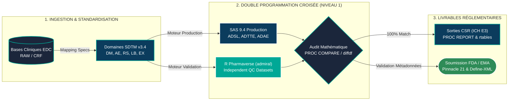

<div align="center">

  <br/>

  

  <h1>
    LEHIE BIOMETRICS 
  </h1>

  <p>
    
  </p>

  <p>
    
    
    
    
  </p>

  <p>
    <a href="mailto:lehie@gmx.fr">
      
    </a>
    
    
  </p>

</div>

---

### I. PRÉSENTATION DU STUDIO

**Lehie Biometrics**  est une structure indépendante de programmation statistique clinique et d'ingénierie biostatistique. Nous concevons des pipelines de données d'essais cliniques (Phases I à IV) soumis aux standards réglementaires internationaux (**FDA, EMA, PMDA**).

Notre protocole d'assurance qualité repose sur la **double programmation indépendante inter-langages (Validation de Niveau 1)** : chaque jeu de données d'analyse produit sous **SAS 9.4** est intégralement contre-programmé sous **R (écosystème Pharmaverse)** et audité mathématiquement avant soumission.

<table width="100%">
  <tr>
    <td width="50%" valign="top">
      <h4 align="center">INGÉNIERIE & STANDARDISATION CDISC</h4>
      <p align="center">
        
        
        
      </p>
      <ul>
        <li><b>Domaines SDTM :</b> Spécifications de mapping et dérivation des domaines d'intervention, d'événements et de résultats (<code>DM</code>, <code>AE</code>, <code>RS</code>, <code>TR</code>, <code>TU</code>, <code>LB</code>, <code>EX</code>).</li>
        <li><b>Modèles d'Analyse ADaM :</b> Architecture <code>ADSL</code>, structures <code>BDS</code> (<code>ADTTE</code>, <code>ADLB</code>, <code>ADRS</code>) et structures d'occurrence <code>OCCDS</code> (<code>ADAE</code>, <code>ADCM</code>).</li>
        <li><b>Conformité eCTD :</b> Contrôle d'intégrité des métadonnées, formats <code>XPT v5</code> et justification documentée (SDRG / ADRG) sous <b>Pinnacle 21</b>.</li>
      </ul>
    </td>
    <td width="50%" valign="top">
      <h4 align="center">MODÉLISATION BIOSTATISTIQUE & TLF</h4>
      <p align="center">
        
        
        
      </p>
      <ul>
        <li><b>Analyse de Survie :</b> Estimateur de Kaplan-Meier, intervalles de confiance de Brookmeyer-Crowley, test du Log-Rank stratifié et modèle de Cox (gestion des ex-aequo d'Efron).</li>
        <li><b>Restitution Réglementaire (ICH E3) :</b> Production automatisée de Tables, Listings et Figures (Sections 14.1, 14.2 et 14.3) prêts pour l'intégration CSR.</li>
        <li><b>Réconciliation Automatisée :</b> Audit croisé systématique via <code>PROC COMPARE</code> (SAS) et <code>diffdf</code> (R) avec tolérance numérique stricte ($10^{-8}$).</li>
      </ul>
    </td>
  </tr>
</table>

---

### II. ARCHITECTURE INTERACTIVE DU PIPELINE RÉGLEMENTAIRE

*Utilisez le panneau de contrôle intégré en haut à droite du schéma pour zoomer et naviguer dans l'architecture de validation **Lehie Biometrics**  :*



---

### III. INSPECTION TECHNIQUE INTERACTIVE

*Cliquez sur les barres ci-dessous pour déployer et inspecter nos standards de code et de validation directement depuis cette page :*

<details>
<summary><b>[DÉPLOYER] 1. Aperçu comparatif : Programmation de la Survie Sans Progression (SAS 9.4 vs R Pharmaverse)</b></summary>
<br/>

```sas
/* --- PRODUCTION SAS 9.4 : Modèle de Cox Stratifié & Kaplan-Meier (Extrait) --- */
proc phreg data=adam.adtte(where=(ittfl="Y" and paramcd="PFS" and anl01fl="Y"));
    class trt01pn(ref="0") strat1 strat2;
    model aval*cnsr(1, 2, 3) = trt01pn / ties=efron rl alpha=0.05;
    strata strat1 strat2;
    ods output ParameterEstimates=_cox_hr;
run;
```

```r
# --- VALIDATION INDÉPENDANTE R : Dérivation ADTTE via {admiral} & Audit {diffdf} ---
qc_comparison <- diffdf::diffdf(
  base      = prod_adtte,
  compare   = qc_adtte,
  keys      = c("STUDYID", "USUBJID", "PARAMCD"),
  tolerance = 1e-8
)
```

</details>

<details>
<summary><b>[DÉPLOYER] 2. Matrice Réglementaire de Censure FDA en Oncologie (ADaM.ADTTE - RECIST 1.1)</b></summary>
<br/>

| Scénario Clinique | Date d'Analyse (`ADT`) | `CNSR` | Description (`EVNTDESC`) | Source (`SRCDOM.SRCVAR`) |
| :--- | :--- | :---: | :--- | :--- |
| **Absence d'évaluation tumorale** et pas de décès | `ADSL.RANDDT` | `2` | No Baseline or Post-Baseline Assessment | `ADSL.RANDDT` |
| **Nouveau traitement anti-cancéreux (`NACTDT`)** avant progression | `LASTTUDT` avant `NACTDT` | `3` | New Anti-Cancer Therapy Prior to Event | `RS.RSDTC` |
| **Progression radiologique documentée (`PD`)** ou Décès | `min(PDDT, DTHDT)` | `0` | Disease Progression or Death | `RS.RSDTC` / `ADSL.DTHDT` |
| **En cours de suivi sans événement** à la date de cut-off | `LASTTUDT` | `1` | Alive and Progression-Free at Cut-Off | `RS.RSDTC` |

</details>

<details>
<summary><b>[DÉPLOYER] 3. Extrait de Rapport de Réconciliation Automatisée Niveau 1 (SAS Production vs R QC)</b></summary>
<br/>

```text
================================================================================
LEHIE BIOMETRICS — AUTOMATED LEVEL 1 DOUBLE PROGRAMMING QC REPORT
================================================================================
Dataset Validated : ADaM.ADTTE (Time-to-Event Analysis Dataset)
Production Engine : SAS 9.4 TS1M7 (programs/01_sas_prod/adtte_prod.sas)
Validation Engine : R 4.4.1 / {admiral} 1.1.0 (programs/02_r_qc/v_adtte_qc.R)
Key Variables     : STUDYID, USUBJID, PARAMCD
Numeric Tolerance : 1.00e-08
Execution Status  : PASS (0 Discrepancies Found across 200 subjects x 23 cols)
================================================================================
FINAL VERDICT: [LEHIE BIOMETRICS QC PASS] - 100% Equivalence Confirmed.
================================================================================
```

</details>

---

### IV. RÉPERTOIRES DE PRODUCTION (FEATURED REPOSITORIES)

<table width="100%">
  <tr>
    <td width="50%" valign="top">
      <h4>
        <a href="https://github.com/lehie-biometrics/cdisc-oncology-adtte-pipeline">01. cdisc-oncology-adtte-pipeline</a>
      </h4>
      <p>
        <b>Oncologie Phase III (RECIST 1.1) — Dérivation <code>ADaM.ADTTE</code> & Analyse de Survie (PFS)</b>
      </p>
      <ul>
        <li>Implémentation complète de la hiérarchie de censure <b>FDA Oncology Guidance</b>.</li>
        <li>Estimation de Kaplan-Meier (IC de Brookmeyer-Crowley), test du Log-Rank stratifié et modèle de Cox sous <code>SAS 9.4</code>.</li>
        <li>Double programmation indépendante sous <code>R {admiral}</code> et audit automatisé <code>{diffdf}</code>.</li>
      </ul>
      <p>
        
        
      </p>
    </td>
    <td width="50%" valign="top">
      <h4>
        <a href="https://github.com/lehie-biometrics/cdisc-safety-adae-tlf-engine">02. cdisc-safety-adae-tlf-engine</a>
      </h4>
      <p>
        <b>Tolérance Clinique (Safety) — Dérivation <code>ADaM.ADAE</code> & Tables Réglementaires ICH E3 14.3.1</b>
      </p>
      <ul>
        <li>Programmation des indicateurs d'événements émergents (<code>TRTEMFL</code>) et des flags de première occurrence (<code>AOCCIFL</code>, <code>AOCCSIFL</code>, <code>AOCCPIFL</code>).</li>
        <li>Algorithmes d'imputation conservatrice des dates partielles d'événements indésirables.</li>
        <li>Restitution hiérarchique par SOC/PT <b>MedDRA v27.0</b> et grade <b>CTCAE v5.0</b> via <code>PROC REPORT</code> et <code>R {rtables}</code>.</li>
      </ul>
      <p>
        
        
      </p>
    </td>
  </tr>
</table>

---

### V. MATRICE DES TECHNOLOGIES & STANDARDS

<div align="center">

| Domaine Technique | Spécifications & Environnements Déployés par **Lehie Biometrics**  |
| :--- | :--- |
| **Moteurs Statistiques** | `SAS 9.4 (TS1M7)` • `SAS Viya` • `R (4.4+)` • `PROC SQL / SQL` • `Python` |
| **Écosystème R Pharmaverse** | `{admiral}` • `{admiralonco}` • `{rtables}` • `{tern}` • `{gt}` • `{diffdf}` • `{sdtm.oak}` • `{haven}` |
| **Procédures SAS Cliniques** | `PROC LIFETEST` • `PROC PHREG` • `PROC MIXED` • `PROC GENMOD` • `PROC REPORT` • `PROC SGPLOT` • `PROC COMPARE` |
| **Normes & Terminologies** | `CDISC SDTM IG 3.4` • `ADaM IG 1.3` • `Define-XML 2.1` • `MedDRA v27.0` • `WHO Drug` • `NCI-CTCAE v5.0` • `RECIST v1.1` |

</div>

---

<div align="center">

  <h4>DIRECTION BIOMÉTRIQUE & COLLABORATION</h4>
  <p>
    Disponible pour les opérations de programmation statistique clinique, de sous-traitance biométrique (CRO / Industrie Pharmaceutique) et d'audit CDISC.<br/><br/>
    <b>LEHIE BIOMETRICS</b>  — <i>Montpellier & Toulouse, France</i><br/>
    <b>Contact Officiel :</b> <a href="mailto:lehie@gmx.fr"><b>lehie@gmx.fr</b></a>
  </p>

</div>
